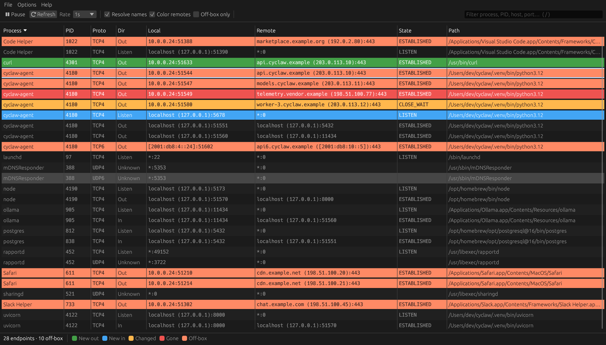
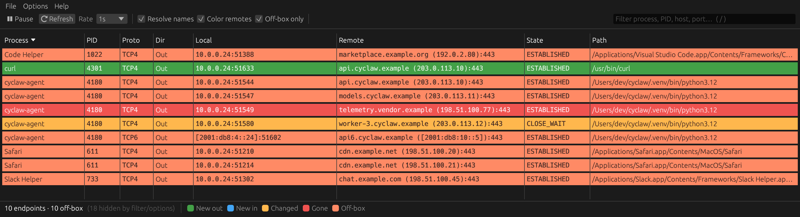
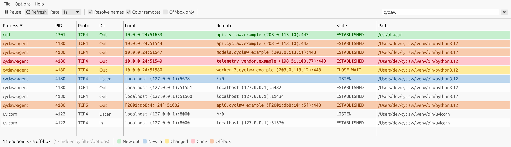
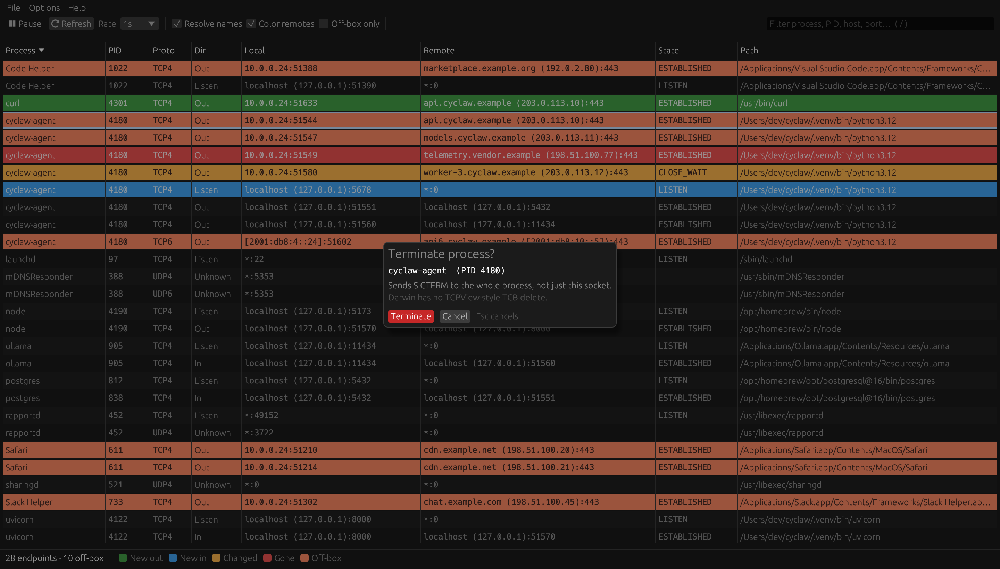

# CyClaw-Net-Viewer

[](https://github.com/cgfixit/CyClaw-Net-Viewer/actions/workflows/ci.yml)
[](rust-toolchain.toml)

macOS 12+ TCP/UDP endpoint viewer for watching process egress—especially while
developing [CyClaw](https://github.com/cgfixit/CyClaw).



*Watching a CyClaw agent while flipping its telemetry kill switch. The agent's
connection to `telemetry.vendor.example` goes **red** (gone), a `curl` check
appears in **green**, a worker drops to `CLOSE_WAIT` in **yellow**, and a new
debug listener shows up in **blue**. Orange rows are steady traffic leaving the
Mac. Names come from reverse DNS, and the observed IP and port stay visible.
Synthetic data, documentation IP ranges only.*

| Process | PID | Proto | Dir | Local | Remote | State | Path |
| --- | ---: | --- | --- | --- | --- | --- | --- |
| nginx | 1042 | TCP4 | Listen | `*:443` | `*:0` | LISTEN | /usr/sbin/nginx |
| curl | 2108 | TCP4 | Out | `127.0.0.1:54321` | `127.0.0.1:443` | ESTABLISHED | /usr/bin/curl |
| mDNSResponder | 301 | UDP4 | Unknown | `*:5353` | `*:0` |  | /usr/sbin/mDNSResponder |

## What it does

- Lists TCP and UDP sockets this Mac will admit through libproc, including IPv4 and IPv6. Columns: process, PID, protocol, direction, local and remote addresses, TCP state.
- Refreshes on a timer (default 1s) with the event colors below.
- Keeps the observed socket IP and port in every cell. Optional reverse DNS is an untrusted label only; it is off by default in the GUI. Long names are shortened before the IP is. CLI `-n` stays numeric.
- When your router has no reverse-DNS answer, Resolve names asks LAN devices
  directly over mDNS. You can also opt in to Quad9 or Cloudflare for public
  peers (**Options → Fallback DNS**, off by default). See
  [Name resolution](#name-resolution).
- Filter (`/` or Cmd+F, Esc clears), sort any column, pause to inspect,
  export visible rows to `~/Downloads` as a private CSV, and terminate the
  owning process after a confirmation.
- Ships a double-click `.app` and a Tcpvcon-style CLI in the same `netboard` binary.

See [Direction](docs/DESIGN.md#direction). Refresh,
deletion, and address rules: [Design](docs/DESIGN.md).

## Colors

| Color | Meaning |
| --- | --- |
| Green | New outgoing endpoint |
| Blue | New incoming endpoint or new LISTEN |
| Yellow | Same 4-tuple, TCP state changed |
| Red | Endpoint gone (two refresh ticks, then drop) |
| Orange | Stable TCP/UDP to an off-box peer (not loopback, not `*`) |

Turn on **Off-box only** when watching CyClaw telemetry-kill. Event colors still win over orange.

## Screenshots

| | |
| --- | --- |
|  | **Off-box only** hides listeners, loopback, and wildcard sockets, leaving only traffic that leaves the Mac. That's what you watch for a telemetry kill. |
|  | **Filter** matches process, PID, host, port, state, or path. The status bar counts what the filter hides. Light and dark follow macOS. |
|  | **Terminate** always asks first. It sends SIGTERM to the whole process, and only if the PID still belongs to the process you confirmed. |

All screenshots use synthetic endpoints with RFC 5737/3849 documentation addresses.

## Name resolution

**Resolve names** (`N`) is off by default. When on, each address goes through:

1. the macOS resolver (hosts file, router/ISP DNS, Bonjour);
2. for RFC 1918 or link-local IPv4 peers the router could not name, one
   mDNS query on the local link. Bonjour/Avahi devices answer for their own
   address. macOS 15+ may ask for Local Network permission the first time;
3. for public peers, only if you pick **Quad9** or **Cloudflare** under
   **Options → Fallback DNS**, a direct PTR query to that resolver over UDP/53.
   This sends those IPs to the provider in cleartext. Private, loopback, and
   documentation addresses are never sent.

Answers must look like a plain hostname, or they are dropped. Misses are
retried after two minutes. Names are untrusted labels, not identities. The
CLI uses step 1 only, and `-n` skips DNS entirely.

## CLI

```text
netboard --cli [-a] [-c] [-n] [process|pid]
```

| Flag | Effect |
| --- | --- |
| (none) | GUI |
| `--cli` | Snapshot to stdout. Default is ESTABLISHED TCP only |
| `-a` | All TCP and UDP endpoints |
| `-c` | CSV |
| `-n` | Numeric addresses, no reverse DNS |
| `process` or `pid` | Optional filter |

## Get the app

Download `CyClaw-Net-Viewer.zip` and `CyClaw-Net-Viewer.zip.sha256` from the
latest [GitHub Release](https://github.com/cgfixit/CyClaw-Net-Viewer/releases/latest).
Releases are built, verified, and attached by the manual
[Release workflow](.github/workflows/release.yml); see
[Cutting a release](CONTRIBUTING.md#cutting-a-release).
No Rust is required to run a downloaded app. Build from source (below) if
you prefer not to use a prebuilt binary.

Verify and unpack on macOS:

```bash
shasum -a 256 -c CyClaw-Net-Viewer.zip.sha256
ditto -x -k CyClaw-Net-Viewer.zip .
codesign --verify --deep --strict CyClaw-Net-Viewer.app
open CyClaw-Net-Viewer.app
```

The binary is ad-hoc signed, not notarized. Gatekeeper may require an
explicit per-app approval; follow the options provided by your macOS
version. Do not disable Gatekeeper system-wide. Ad-hoc signatures and
checksums do not identify a trusted publisher. Do not App-Sandbox the
bundle: that hides other processes' sockets.

Requires macOS 12 or newer, Intel or Apple Silicon. Release and CI
bundles verify universal `arm64` + `x86_64` builds. Local builds can
fall back to the host architecture.

Maintainers who need a specific unreleased commit may download the
14-day [Bundle workflow](https://github.com/cgfixit/CyClaw-Net-Viewer/actions/workflows/bundle.yml)
artifact themselves (GitHub sign-in required). Prefer the reviewed run for
the exact commit you need. Those zips are not the public distribution
channel. PR artifacts contain proposed changes and are for review only.

## Build from source

Rust **1.85.0** is the minimum supported version (`rust-toolchain.toml`).
CI also checks current stable on Apple Silicon and Intel. Clone the default
`main` branch:

```bash
export PATH="$HOME/.cargo/bin:$PATH"
git clone https://github.com/cgfixit/CyClaw-Net-Viewer.git CyClaw-Net-Viewer
cd CyClaw-Net-Viewer
rustup toolchain install 1.85.0
./scripts/check.sh
cargo run --locked
cargo run --locked -- --cli -n -a
./scripts/make-app.sh          # dist/CyClaw-Net-Viewer.app
./scripts/make-app.sh --dmg    # dist/CyClaw-Net-Viewer.dmg
```

See [docs/BUILD.md](docs/BUILD.md). To verify with the current compiler without
changing the repository pin:

```bash
rustup update stable
RUSTUP_TOOLCHAIN=stable ./scripts/check.sh
cargo +stable build --release --locked
```

## Verify

On macOS, `./scripts/check.sh` runs the same Rust checks as CI: `rustfmt`,
Clippy (`-D warnings`), and `cargo test --locked` (including the native Bash
egress fixture). For a focused observation and cleanup check:

```bash
./scripts/emulate-egress-sandbox.sh
```

The `emulate-egress-sandbox` skill in `.agents/skills` wraps that script.
Shared skills also include `verify-netviewer-rust`, `verify-netviewer-bundle`,
`netviewer-sandbox`, `refactor-netviewer`, and `netviewer-invariants`.
See `AGENTS.md` for when to load each one. Windows and Linux cannot run
this Darwin library; use the
[macOS CI results](https://github.com/cgfixit/CyClaw-Net-Viewer/actions/workflows/ci.yml).

Runtime boundaries (no App Sandbox, confirmed SIGTERM, numeric CLI, private
CSV): [SECURITY.md](SECURITY.md).

## Docs

- [Design](docs/DESIGN.md)
- [Security](SECURITY.md)
- [Build](docs/BUILD.md)
- [Controls](docs/CONTROLS.md)
- [Known issues](docs/KNOWN_ISSUES.md)
- [Egress harness](docs/EGRESS_SANDBOX.md)
- [Contributing](CONTRIBUTING.md)
- [User guide (PDF)](docs/CyClaw-Net-Viewer-User-Guide.pdf)
- [How it works (PDF)](docs/CyClaw-Net-Viewer-How-It-Works.pdf)

## License

Inspired by Sysinternals
TCPView. Not affiliated with Microsoft.

MIT. See [LICENSE](LICENSE).
